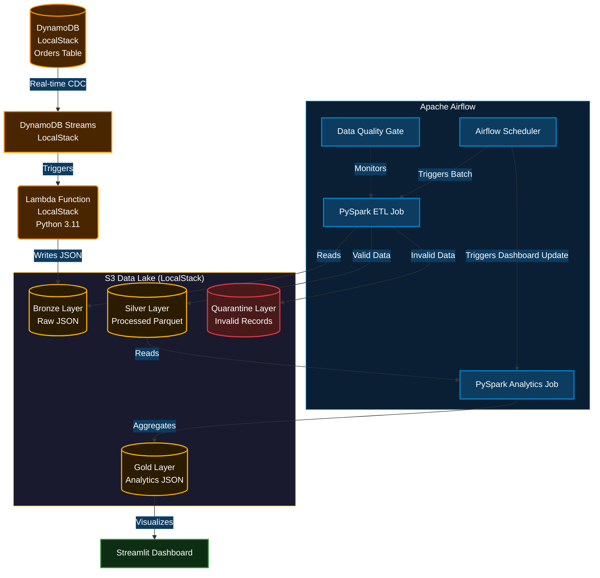
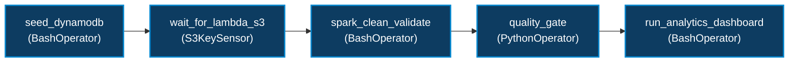
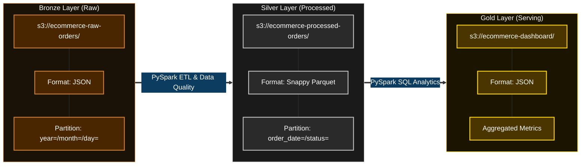
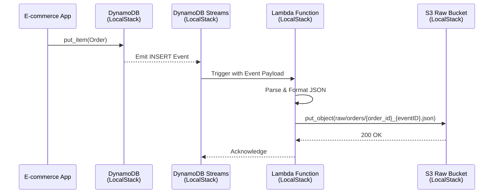

# Real-Time E-commerce Data Lakehouse Pipeline

[](https://github.com/arsalankazi/dynamodb-airflow-lakehouse-pipeline/actions/workflows/ci.yml)

<div align="center">
  
  
  
  
  
</div>

---

## 📖 Project Overview

An end-to-end, production-grade **Data Engineering pipeline** that captures real-time e-commerce order data from **DynamoDB (LocalStack)**, streams it via **Lambda (LocalStack)** to an **S3 Data Lake (LocalStack)**, transforms it using **PySpark**, orchestrates it with **Apache Airflow**, and visualizes business metrics on a **Streamlit Dashboard**.

This project demonstrates the **Medallion Architecture** (Raw → Processed) and event-driven design, built entirely locally using **Docker** and **LocalStack** (zero cloud infrastructure costs). It also includes a fully automated **CI/CD pipeline** with unit testing and code linting.

---

## 🏗️ 1. System Architecture

The pipeline uses a modern, serverless, event-driven architecture. All AWS services are emulated locally via **LocalStack**.



---

## 🌬️ 2. Airflow DAG Flow

The pipeline is orchestrated by a custom Airflow DAG (`orders_lakehouse_etl`) that manages dependencies, retries, data quality gates, and automated dashboard aggregation.



---

## 🥉 3. Data Lakehouse (Medallion) Architecture

Our S3 Data Lake (emulated via **LocalStack**) is organized into distinct layers for scalability and re-processing:



---

## ⚡ 4. Event-Driven Sequence Diagram

How a single order flows through the system in near real-time. Every AWS hop is handled by **LocalStack**.



---

## 🛠️ Tech Stack

| Category | Technologies |
| :--- | :--- |
| **Orchestration** | Apache Airflow, Docker Compose |
| **Data Storage** | S3 Data Lake (LocalStack), DynamoDB (LocalStack) |
| **Compute & ETL** | PySpark, AWS Lambda (LocalStack), Pandas |
| **Local AWS Emulation** | **LocalStack**, WSL2 (Windows) |
| **Visualization** | Streamlit, Plotly |
| **CI/CD & Testing** | GitHub Actions, PyTest, Ruff |
| **Languages** | Python, SQL, Bash |

---

## 🌟 Key Engineering Features

- **Append-Only CDC History:** Lambda uses a composite key of `order_id` and DynamoDB `eventID` for S3 object names, creating an immutable append-only event log. Lambda also injects `event_timestamp` into the JSON payload for downstream ordering.
- **Silver Layer Deduplication:** PySpark applies window deduplication (`ROW_NUMBER() OVER (PARTITION BY order_id ORDER BY event_timestamp DESC)`) to serve the latest state to dashboards, while retaining full event history in the Silver layer.
- **Data Quality & Quarantine:** PySpark enforces strict schemas. Invalid records (e.g., negative price, missing IDs) are routed to a dedicated Quarantine S3 bucket to prevent downstream corruption.
- **Hive Partitioning:** S3 data is partitioned (`year=/month=/day=/`). This enables **Partition Pruning**, significantly reducing data scanned during queries.
- **Quality Gate Circuit Breaker:** PySpark writes `_quality/metrics.json` to S3. The Airflow `PythonOperator` reads it and fails the DAG if `failure_rate > 20%`.
- **OS-Agnostic IaC:** A Python-based deployment script (`deploy.py`) is used instead of Bash for cross-platform compatibility (Windows/Mac/Linux).
- **Volume Validation:** Smoke-tested the pipeline at a 10,000-record batch size to verify PySpark partition writes and S3 layout stability.
- **Automated CI/CD:** GitHub Actions workflow runs on every push to lint code (`ruff`) and execute unit tests (`pytest`).

---

## 🔄 End-to-End Execution Flow (Step-by-Step)

This pipeline is designed to be fully reproducible. Here is the exact execution flow of all scripts and components:

| Step | Script / Component | Action Performed |
| :--- | :--- | :--- |
| **1. Setup** | `python deploy.py` | Spins up Docker containers (Airflow, LocalStack, Postgres, Streamlit). Provisions S3 buckets, DynamoDB table (with Streams), and deploys the Lambda function. |
| **2. Chaos Test (Optional)** | `python scripts/verify_quarantine.py --inject` | Injects a deliberately invalid record (negative price) into DynamoDB to test the Data Quality gate. |
| **3. Orchestration** | Airflow UI (`localhost:8080`) | Trigger the `orders_lakehouse_etl` DAG. Airflow manages the sequence of steps below. |
| **4. Seed Data** | `scripts/seed_orders.py` (via Airflow) | Generates 10,000 mock orders and inserts them into DynamoDB. |
| **5. Ingestion** | `lambda/dynamodb_stream_to_s3.py` (via LocalStack) | DynamoDB Streams trigger the Lambda, which writes raw JSON to the S3 Bronze layer. |
| **6. Transformation** | `spark_jobs/clean_orders.py` (via Airflow) | PySpark reads Bronze JSON, deduplicates using Window functions, routes bad data to Quarantine, and writes Parquet to the Silver layer. |
| **7. Analytics** | `spark_jobs/analytics_query.py` (via Airflow) | PySpark aggregates Silver Parquet data into JSON metrics for the Gold layer. |
| **8. Verification** | `python scripts/verify_quarantine.py` | Fetches the Quarantine records and Quality Metrics from S3 to prove the pipeline handled data correctly. |
| **9. Visualization** | Streamlit UI (`localhost:8501`) | Displays the Gold layer metrics on an interactive dashboard. |
| **10. Teardown** | `python destroy.py` | Stops all Docker containers and wipes the LocalStack volume to ensure a clean slate for the next run. |

---

## 🧪 Testing & Code Quality

To ensure production-grade reliability, the project includes **Ruff** for PEP 8 linting and **PyTest** for DAG integrity and PySpark transformation testing.

Run tests locally inside the Docker container:

```bash
# Linux / macOS
docker compose exec airflow-scheduler pytest /opt/airflow/tests/ -v

# Windows (git-bash) — MSYS path conversion must be disabled
MSYS_NO_PATHCONV=1 docker compose exec airflow-scheduler pytest /opt/airflow/tests/ -v
```

---

## 📂 Project Structure

```text
.
├── .github/workflows/     # GitHub Actions CI/CD pipeline
├── dags/                  # Airflow DAG definitions
├── lambda/                # DynamoDB Stream to S3 Lambda code (LocalStack)
├── spark_jobs/            # PySpark ETL & Analytics scripts
├── dashboards/            # Streamlit App code
├── scripts/               # Supporting scripts (seed_orders.py, verify_quarantine.py)
├── tests/                 # PyTest suite
├── deploy.py              # OS-Agnostic Infrastructure Provisioning (LocalStack)
├── destroy.py             # Environment Teardown Script
├── docker-compose.yml     # Multi-container orchestration
├── pyproject.toml         # Ruff linter configuration
├── requirements.txt       # Python dependencies
├── .env.example           # Sanitized environment variables template
├── .gitignore             # Exclusion rules for secrets, logs, and venv
└── LICENSE                # MIT License
```

---

## 🚀 How to Run Locally

### Prerequisites

- Docker Desktop installed and running.
- **Hardware:** 8GB+ RAM allocated to Docker Desktop.
- Python 3.10+ installed.
- AWS CLI (optional, for LocalStack inspection).

### 1. Clone the Repository

```bash
git clone https://github.com/arsalankazi/dynamodb-airflow-lakehouse-pipeline.git
cd dynamodb-airflow-lakehouse-pipeline
```

### 2. Setup Environment

```bash
cp .env.example .env
pip install -r requirements.txt
```

### 3. Deploy Infrastructure

```bash
python deploy.py
```

### 4. Trigger the Pipeline

1. Open Airflow UI: `http://localhost:8080` (admin/admin)
2. Unpause and trigger the `orders_lakehouse_etl` DAG.

### 5. View Dashboard

Open Streamlit: `http://localhost:8501`

### 6. Verify Data Quality & Quarantine

Run the diagnostic script to verify that bad data was routed to the DLQ.

```bash
python scripts/verify_quarantine.py
```
*(To test the flow from scratch, run `python scripts/verify_quarantine.py --inject` BEFORE triggering the DAG).*

### 7. Clean Up (Optional)

```bash
python destroy.py
```

---

## 🔒 Security & Configuration

- **No Hardcoded Secrets:** The repository does not contain any real AWS credentials. Mock credentials (`test`) are used exclusively for the **LocalStack** environment.
- **Environment Variables:** Sensitive configurations (Airflow passwords, LocalStack keys) are managed via a `.env` file, which is strictly git-ignored.
- **Local Dev Defaults:** For local emulation, default credentials (`admin`/`admin`) are provided in `.env.example`. For production deployments, these would be replaced by **AWS Secrets Manager** or GitHub Actions Secrets.
- **Idempotent Scripts:** The IaC deployment scripts are idempotent. They can be run safely multiple times without causing resource duplication.
- **Network Isolation:** All LocalStack ports (`4566`), Airflow (`8080`), and Streamlit (`8501`) are bound to `127.0.0.1`, not exposed publicly.

---

## 🔮 Future Improvements

- **Migrate IaC:** Replace `deploy.py` boto3 scripting with **Terraform** for declarative infrastructure provisioning targeting real cloud in production.
- **Data Profiling:** Integrate **Great Expectations** for deeper data quality profiling.
- **Container Registry:** Add deployment steps to push Docker images to a container registry (e.g., Amazon ECR in production).

---

## 👨‍💻 Author & Maintainer

<p align="left">
  
</p>

### **Kazi Arsalan Ajaj Ahmed**
*Data Engineer | Big Data & Cloud*

[](https://github.com/arsalankazi)
[](https://linkedin.com/in/arsalankazi)
[](mailto:kaziarsalan810@gmail.com)

---

### 🎯 Core Engineering Focus

- **Event-Driven Architecture:** DynamoDB Streams, Lambda Triggers, Serverless CDC & Real-Time Ingestion (all via LocalStack).
- **Medallion Lakehouse:** Bronze/Silver/Gold Layering, Hive-Partitioned Parquet, Snappy Compression & Data Quality Gates.
- **CI/CD & Testing:** GitHub Actions, PyTest, Ruff Linting, DAG Integrity & PySpark Transformation Testing.